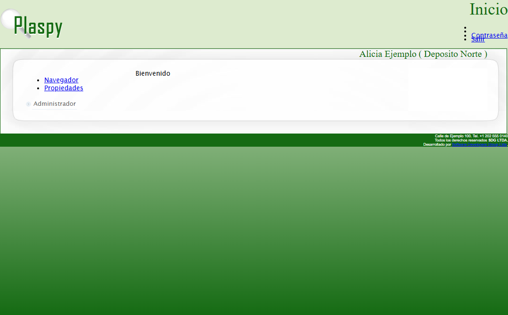
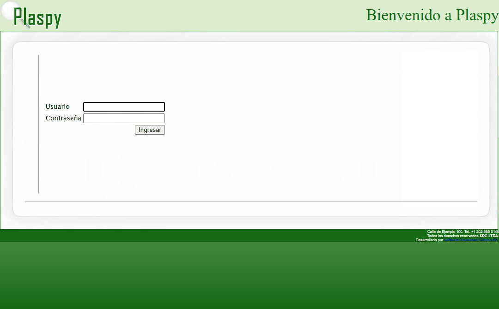

# Gestión de inventarios histórica / Historical inventory management

[English](#english) · [Español](#español)

## English

Archived Web Forms site for recording stock receipts, issues and transfers across warehouses

> [!WARNING]
> **Status: Archived.** The website compiles today with the documented Windows toolchain.

### Overview

The recovered Web Forms site tracks stock and movements separately for each warehouse. The newest archived website dates to June 2015. The November 2026 work documents the reconstruction and adds local test tools.

### Features

- Open stock transformations in `inventarios/almacen/transformaciones.aspx`.
- Open the production process data in `inventarios/produccion/proceso.aspx`.
- Sign in with a local inventory account through `inventarios/Default.aspx`.
- Record incoming stock at `inventarios/almacen/entrada.aspx`.
- Record stock withdrawals at `inventarios/almacen/salida.aspx`.
- Move stock between warehouse locations at `inventarios/almacen/traslado.aspx`.
- Maintain product records at `inventarios/administrador/productos.aspx`.
- Configure the inventory options at `inventarios/administrador/configuracion.aspx`.
- Maintain business contacts at `inventarios/administrador/terceros.aspx`.
- Prepare product formulas at `inventarios/produccion/formulacion.aspx`.
- Consult production orders at `inventarios/produccion/orden.aspx`.
- Record the laboratory entries at `inventarios/produccion/laboratorio.aspx`.

### Build

Install x64 Windows with .NET Framework 4.8 ASP.NET, its Developer Pack, .NET SDK 11.0.100, and Python 3.12.4. The command builds the own library and precompiles the pages in a temporary copy. Choose a new output directory.

```powershell
python demo/compilar.py --output "$env:TEMP/inventarios-compilado"
```

To run the site, host it in IIS Express and configure an isolated MySQL database through `MySql.Data.MySqlClient`. The build template omits deployment connections.

The application runs without activation. The original own license check is kept under `ENABLE_LICENSE_CHECK`.

The optional forms storage uses LitS3. Leave `s3Key` and `s3Password` empty to use local files via `ruta_formatos`. Storage testing uses a mock S3 service and generated credentials. The live service requires an account.

See [THIRD-PARTY-NOTICES.md](THIRD-PARTY-NOTICES.md) for the notices and SHA-256 values of recovered dependencies.

### Local demonstration

The fictional MySQL schema is named `demo_inventory`.

Start `docker compose -f demo/compose.yaml up -d` with fictional generated hexadecimal values for `INVENTARIO_DEMO_ROOT`, `INVENTARIO_DEMO_LOGIN`, and `INVENTARIO_DEMO_S3_KEY`. The demo creates a warehouse, an item, and the `alicia_demo` account. Configure IIS Express with `MySql.Data.MySqlClient`, MySQL at `127.0.0.1:53306`, database `demo_inventory`, user `inventario_demo`, and the generated value of `INVENTARIO_DEMO_LOGIN` as the test password. Set `InventoryDatabase=demo_inventory` in `appSettings`. Sign in as `alicia_demo` with that fictional password.

For forms storage set `s3LocalPort=58090`, `s3Key` to the generated value of `INVENTARIO_DEMO_S3_KEY`, and `s3Password` to a separate generated test value. The local S3 mock checks the key identifier. The mock runs on loopback. The trial checked upload, listing, download, and deletion. The live service requires an account and was outside the trial. Remove the containers with `docker compose -f demo/compose.yaml down --volumes`.





### Requirements and dependencies

The archived installation SQL in `inventarios/db/` and the deployed configuration contain installation accounts and settings. The reconstruction leaves those files in the source archive. The `demo/` directory supplies a disposable database schema and fictional records. The C# generated from the archived assembly in 2026 builds the matching component library.

The 2026 adaptations described here include changes to `CUsuario.cs` and `formato.cs`.

The recovered template resources for this cut come from the March 1, 2014 archive. The third-party notices list the files and their exact hashes.

The 2026 reconstruction decompiled the period SDG.Componentes assembly into src/SDG.Componentes/. The build compiles these reconstructed C# sources. The archived DES helper uses fictitious material.

MySQL Connector/NET 6.3.5.0 is included. The archived optional adapters use BeIT.MemCached 1.0.0.0 and LitS3 1.0.1.0.

### Project structure

The recovery includes the archived menu definition `inventarios/directorio.xml` dated 2014-03-01, and 22 interface graphics from the same source.

`inventarios/` has the pages and stock workflows. `src/SDG.Componentes/` builds the C# reconstruction of the period assembly. `demo/` contains build and local-service scripts. `demos/ejemplo.json` is a fictional stock-transfer example added during reconstruction. `docs/media/` contains the actual login form and the authenticated home from the local test of this snapshot.

### Usage and limits

Sign in to the local site to see the example warehouse on the home page. The tests use generated credentials and fictional records. Coverage includes sign-in, display of the example warehouse and the four operations against the local mock storage service.

### Verification

The local demo grants read access to Products. In the authenticated menu, open Products and look for the fictional item H-501, Llave de ensayo. The trial covers the catalogue read and leaves edits and deletes outside its scope.

A follow-up verification of the November 23 snapshot used its recorded application inputs on November 24, 2026, under Windows with ASP.NET Compiler 4.8.10001.0, IIS Express 10.0.26013.1000, .NET SDK 11.0.100, Python 3.12.4 and disposable MySQL 5.6.51. The Build command succeeded. The local account opened the warehouse home page. Docker Compose 5.6.1 started the fictional database and storage endpoint and both passed their checks.

### History

Four archived editions use the order template from the source tree. The conflict copy of that template stays in the corresponding backup. Other snapshots retain the warehouse source conflict copy as part of that archived tree.

The Web Forms history begins with the November 2012 archive, continues through the 2013 editions and includes a documentation-only snapshot. The latest archived website is dated June 17, 2015. The 2026 commits add the bilingual guide, fictional data and independent tests for the archived application.

### Keys for IIS

Generate an eight-character ASCII key for each setting and set it in the IIS worker process. Each installation uses its own keys.

- `INVENTORY_STATE_KEY` saves and restores form state.

### License

The application uses [MIT](LICENSE).

### Support

Share reproducible issues and use fictional records in examples and screenshots.

### Contributing

Identify the snapshot and reproduce the case with fictional data.

---

## Español

Archivado — Sitio Web Forms para registrar entradas, salidas y traslados de existencias entre almacenes

> [!WARNING]
> **Estado: archivado.** El sitio compila hoy con las herramientas de Windows indicadas.

### Descripción general

El sitio Web Forms recuperado controla existencias y movimientos por almacén. El sitio archivado más reciente es de junio de 2015. El trabajo de noviembre de 2026 documenta la reconstrucción y agrega herramientas para las pruebas locales.

### Funciones

- Abre las transformaciones de existencias en `inventarios/almacen/transformaciones.aspx`.
- Abre los datos del proceso de producción en `inventarios/produccion/proceso.aspx`.
- Inicia sesión con una cuenta local de inventarios desde `inventarios/Default.aspx`.
- Registra entradas de existencias en `inventarios/almacen/entrada.aspx`.
- Registra salidas de existencias en `inventarios/almacen/salida.aspx`.
- Registra traslados entre ubicaciones en `inventarios/almacen/traslado.aspx`.
- Mantén las fichas de productos en `inventarios/administrador/productos.aspx`.
- Configura las opciones de inventario en `inventarios/administrador/configuracion.aspx`.
- Mantén los contactos comerciales en `inventarios/administrador/terceros.aspx`.
- Prepara fórmulas de productos en `inventarios/produccion/formulacion.aspx`.
- Consulta órdenes de producción en `inventarios/produccion/orden.aspx`.
- Registra los datos de laboratorio en `inventarios/produccion/laboratorio.aspx`.

### Cómo empezar a compilar

Necesitas Windows x64 con ASP.NET de .NET Framework 4.8, su Developer Pack, el SDK .NET 11.0.100 y Python 3.12.4. El comando recompila la biblioteca propia y precompila las páginas desde una copia temporal. Usa una carpeta de salida nueva.

```powershell
python demo/compilar.py --output "$env:TEMP/inventarios-compilado"
```

Para ejecutar el sitio, hospédalo en IIS Express y configura una base MySQL aislada con el proveedor `MySql.Data.MySqlClient`. La plantilla de compilación deja fuera las conexiones de despliegue.

El código propio se ejecuta sin activación. La comprobación original queda bajo `ENABLE_LICENSE_CHECK`.

El almacenamiento opcional de formatos usa LitS3. Deja vacíos `s3Key` y `s3Password` para usar archivos locales mediante `ruta_formatos`. Las pruebas de almacenamiento usan un servicio S3 ficticio y credenciales generadas. El servicio real requiere una cuenta.

Los avisos y SHA-256 de las dependencias recuperadas están en [THIRD-PARTY-NOTICES.md](THIRD-PARTY-NOTICES.md).

### Demostración local

El esquema MySQL ficticio se llama `demo_inventory`.

Inicia `docker compose -f demo/compose.yaml up -d` con valores hexadecimales ficticios generados para `INVENTARIO_DEMO_ROOT`, `INVENTARIO_DEMO_LOGIN` e `INVENTARIO_DEMO_S3_KEY`. La demo crea un almacén, un artículo y la cuenta `alicia_demo`. Configura el sitio de IIS Express con `MySql.Data.MySqlClient`, MySQL en `127.0.0.1:53306`, esquema `demo_inventory`, usuario `inventario_demo` y el valor generado de `INVENTARIO_DEMO_LOGIN` como clave de prueba. Usa `InventoryDatabase=demo_inventory` en `appSettings`. Para ingresar al sitio, usa `alicia_demo` y esa clave ficticia.

Para el almacenamiento de formatos configura `s3LocalPort=58090`, `s3Key` con el valor generado de `INVENTARIO_DEMO_S3_KEY` y `s3Password` con otro valor ficticio generado. El servidor S3 local comprueba el identificador de la clave. El servidor falso escucha en loopback. Se comprobaron carga, listado, descarga y borrado. El servicio real requiere una cuenta y quedó fuera de la prueba. Retira los contenedores con `docker compose -f demo/compose.yaml down --volumes`.


### Requisitos y dependencias

El SQL de instalación archivado en `inventarios/db/` y la configuración desplegada contienen cuentas y ajustes de instalación. La reconstrucción conserva esos archivos en el respaldo de fuentes. `demo/` trae un esquema desechable y registros ficticios. El C# generado a partir del ensamblado archivado en 2026 compila la biblioteca correspondiente.

Las adaptaciones de 2026 descritas aquí incluyen cambios en `CUsuario.cs` y `formato.cs`.

Los recursos de plantilla recuperados para este corte proceden del respaldo del 1 de marzo de 2014. Los avisos de terceros enumeran los archivos y sus huellas exactas.

La reconstrucción de 2026 descompiló el ensamblado de época SDG.Componentes en src/SDG.Componentes/. La compilación usa esos fuentes C# reconstruidos. El auxiliar DES archivado usa material ficticio.

El árbol incluye MySQL Connector/NET 6.3.5.0. Los adaptadores opcionales usan BeIT.MemCached 1.0.0.0 y LitS3 1.0.1.0.

### Estructura

La recuperación incluye la definición del menú archivado `inventarios/directorio.xml` del 2014-03-01 y 22 gráficos de interfaz del mismo respaldo.

`inventarios/` contiene las páginas y los movimientos. `src/SDG.Componentes/` compila la reconstrucción C# del ensamblado de época. `demo/` contiene los scripts de compilación y servicios locales. `demos/ejemplo.json` es un ejemplo ficticio de movimientos añadido durante la reconstrucción. `docs/media/` contiene el formulario y la portada autenticada de la prueba local de este corte.

### Uso y alcance

Ingresa al sitio local para ver el almacén de ejemplo en Inicio. La prueba usa datos ficticios y claves generadas. Se comprobó el ingreso, la visualización del almacén de ejemplo y las cuatro operaciones del almacenamiento ficticio.

### Verificación

La demo local concede acceso de lectura a Productos. En el menú autenticado, abre Productos y busca H-501, Llave de ensayo. La prueba cubre la consulta del catálogo. La edición y el borrado quedan fuera del ensayo.

El 24 de noviembre de 2026 se hizo una verificación posterior del corte del 23 de noviembre con sus insumos de aplicación registrados, en Windows con ASP.NET Compiler 4.8.10001.0, IIS Express 10.0.26013.1000, SDK .NET 11.0.100, Python 3.12.4 y MySQL 5.6.51 desechable. El comando de compilación terminó correctamente. La cuenta local abrió el inicio del almacén. Docker Compose 5.6.1 inició la base y el almacenamiento ficticios y ambos pasaron las pruebas.

### Historial

Cuatro ediciones archivadas usan la plantilla de órdenes del árbol fuente. Su copia en conflicto queda en el respaldo correspondiente. Otros cortes conservan la copia en conflicto del archivo fuente de almacenes como parte de su árbol archivado.

La historia Web Forms empieza con el respaldo de noviembre de 2012, continúa con las ediciones de 2013 e incluye un corte exclusivamente documental. El último sitio archivado es del 17 de junio de 2015. Los commits de 2026 agregan la guía bilingüe, los datos ficticios y las pruebas aisladas.

### Claves de IIS

Genera una clave ASCII de ocho caracteres para cada variable y defínela en el proceso de IIS. Cada instalación usa sus propias claves.

- `INVENTORY_STATE_KEY` guarda y restaura el estado de los formularios.

### Licencia

La aplicación usa [MIT](LICENSE).

### Soporte

Al informar de un problema, incluye cómo reproducirlo y usa registros ficticios en ejemplos y capturas.

### Contribuir

Indica el corte y reproduce el caso con datos ficticios.
